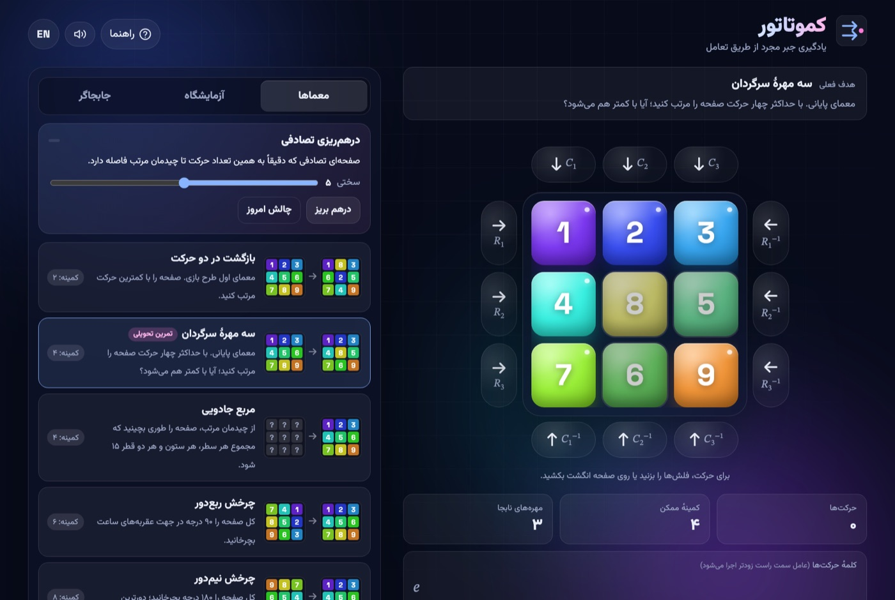

# Kommutator · کموتاتور

[](https://github.com/soyapo/kommutator/actions/workflows/pages.yml)

**Play it: <https://soyapo.github.io/kommutator/>**

A browser game that teaches the first ideas of group theory by touch. The board
is a 3×3 grid holding the tiles 1–9. The only moves are cyclic shifts of a row
to the right (`R₁ R₂ R₃`) or of a column downwards (`C₁ C₂ C₃`), plus their
inverses. Every move is a permutation, every sequence of moves is a word in the
generators, and the tool that solves almost every puzzle is the commutator
`[g, h] = g h g⁻¹ h⁻¹`.

The game was designed by **Behzad Najafi** as a teaching device for an
abstract-algebra course. This repository contains a web implementation of the
game and the written solution of the course's final puzzle.

<div dir="rtl">

«کموتاتور» یک بازی فکری آموزشی برای صفحهٔ ۳×۳ است که بازیکن را با ایده‌های
اصلی نظریهٔ گروه‌ها ــ مولد، معکوس، عضو همانی، جایگشت و جابجاگر ــ از راه حرکت
دادن واقعی مهره‌ها آشنا می‌کند. این مخزن نسخهٔ وب بازی (با رابط فارسی و
انگلیسی) و حل معمای پایانی درس را در بر دارد.

</div>



## Features

- Animated row and column rotations with wrap-around; tap the arrows or **swipe
  on the board**. Persian (RTL) interface by default, English with one tap.
- **Puzzles**: the two puzzles of the original proposal (the final one is the
  homework), the Lo Shu magic square, a quarter turn, a half turn (the farthest
  position there is), pattern goals, and one deliberately impossible target,
  the mirror image, which is an odd permutation.
- **Exact-difficulty scrambles** (2–8 moves) and a **daily challenge** that is
  identical for everyone on the same date.
- **Hint** and **auto-solve** always give a shortest route: a breadth-first
  search over all 181 440 reachable positions runs once in a Web Worker.
- Live **word of moves** in the function-composition convention (rightmost
  factor first), execution order, reduced word, cycle notation, element order,
  parity and distance from the ordered board.
- A **tile-path overlay** that draws where every misplaced tile has to go, and
  a **commutator lab** that shows `[g, h]` for any two moves on a mini board.
- Shareable links: `#p=p2` (a built-in puzzle), `#s=123485769` (any position),
  `#daily`.
- Works offline-free of build steps: three static files, no dependencies except
  Google Fonts.

## Rules and notation

| Symbol | Meaning |
| --- | --- |
| `Rᵢ` | row *i* rotates one cell to the right; the right-edge tile wraps to the left |
| `Cⱼ` | column *j* rotates one cell down; the bottom tile wraps to the top |
| `Rᵢ⁻¹`, `Cⱼ⁻¹` | the inverse moves (left / up) |
| `Rᵢ³ = Cⱼ³ = e` | three applications restore the board |
| `Y X` | first apply `X`, then `Y` (the rightmost factor is executed first) |
| `[g, h] = g h g⁻¹ h⁻¹` | the commutator of two moves |

Rows are numbered from the top and columns from the left. Cells are named after
the tile that belongs there in the ordered board, so `R₂ = (4 5 6)` and
`C₂ = (2 5 8)` as permutations of cells.

Some facts the game lets you discover: every move is a 3-cycle, hence an even
permutation, so exactly half of the 9! arrangements are reachable (the
alternating group A₉, 181 440 positions); no position is more than 8 moves from
the ordered board; and a row and a column that cross in one cell have a
commutator that is a 3-cycle on that cell and its two neighbours, which is
exactly what you need to fix three "L-shaped" tiles.

## Repository layout

```
kommutator/
├── game/                 the web game (deployed to GitHub Pages)
│   ├── index.html
│   ├── style.css
│   ├── app.js            engine, solver, puzzles, i18n, UI
│   └── README.md         technical notes for the site
├── solution/             written solution of the final puzzle (Persian)
│   ├── solution.pdf      the deliverable
│   ├── solution.template.html
│   ├── build.py          generates every board figure from a verified simulation
│   └── render.sh         builds solution.html and prints the PDF
├── assets/screenshot.jpg
└── .github/workflows/pages.yml
```

## Run locally

Open `game/index.html` in a browser, or serve the folder so the Web Worker and
share links behave exactly as they do online:

```bash
python3 -m http.server 8000 --directory game
```

Then visit <http://localhost:8000/>.

## Deploy to GitHub Pages

The workflow in `.github/workflows/pages.yml` publishes the `game/` folder on
every push to `main` that touches it.

1. In the repository settings open **Pages → Build and deployment** and set
   **Source** to **GitHub Actions** (one-time step).
2. Push to `main`. The badge at the top of this file turns green when the site
   is live at <https://soyapo.github.io/kommutator/>.

To host the game anywhere else, copy the three files in `game/` to any static
web server.

## Rebuild the solution PDF

The PDF is rendered from HTML with a headless Chromium browser (Microsoft Edge
or Google Chrome) and the Vazirmatn web font, so no LaTeX installation is
needed:

```bash
./solution/render.sh
```

`build.py` simulates the moves, asserts that the drawn boards reach the ordered
board, re-verifies by exhaustive search that the puzzle needs exactly four
moves, and only then fills the template.

## Credits

- Game design and course proposal: Behzad Najafi.
- Web implementation and solution write-up: this repository's author, for the
  abstract-algebra course.
- Fonts: [Vazirmatn](https://github.com/rastikerdar/vazirmatn), Space Grotesk
  and STIX Two Text via Google Fonts.
